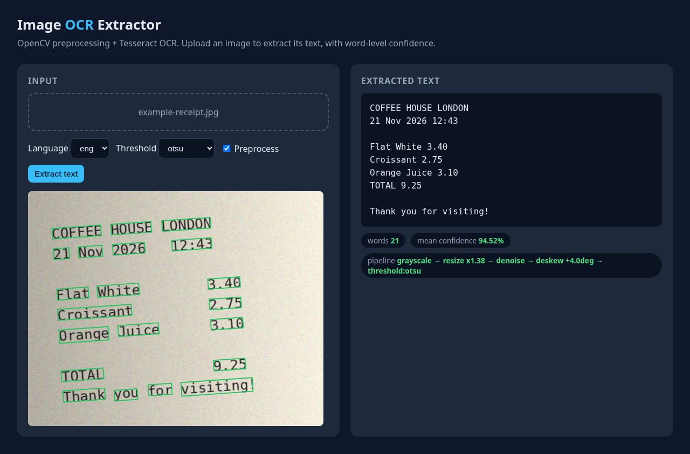
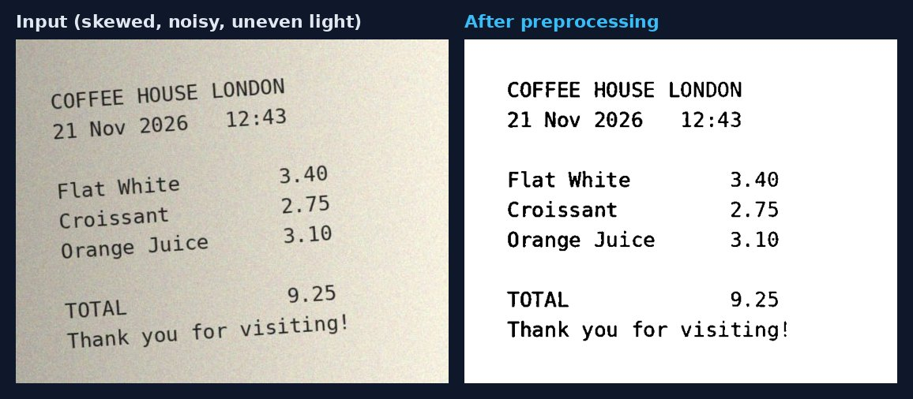

# Image OCR Extractor

[](https://github.com/mzhyhan/image-ocr-extractor/actions/workflows/ci.yml)
[](https://www.python.org/)
[](#testing)
[](https://mypy-lang.org/)
[](LICENSE)
[](https://github.com/astral-sh/ruff)

**Extract text from photos, scans and screenshots.** An OpenCV preprocessing pipeline cleans the image up, then Tesseract OCR reads it. You can use it as a Python library, a command-line tool or a small web app, and you get plain text or JSON with per-word confidence scores and bounding boxes.



## Features

- **Preprocessing pipeline**: grayscale, upscaling, denoising, Otsu or adaptive thresholding, and automatic deskew. You can switch each step on or off.
- **Structured output**: per-word text, confidence (0–100) and bounding box, grouped into lines, plus mean confidence.
- **Multi-language support**: any installed Tesseract language pack (`eng`, `ukr`, `eng+ukr`, …).
- **CLI**: `ocr-extract` handles batches of files and can output text or JSON to stdout or a file.
- **REST API and web UI**: a FastAPI `/ocr` endpoint with OpenAPI docs, plus a drag-and-drop page that draws confidence-coloured boxes over the image.
- **Production-ready setup**: Google-style docstrings throughout, strict mypy, ruff, pre-commit hooks, a pytest suite with doctests and 98% coverage (no binary fixtures), GitHub Actions CI on Python 3.10–3.12, and a Docker image with a health check.

## Tech stack

Python 3.10+ · Tesseract 5 via `pytesseract` · OpenCV · NumPy · Pillow · FastAPI · Uvicorn · pytest · mypy · ruff · pre-commit · Docker · GitHub Actions

## Quickstart

### Local

You need [Tesseract](https://tesseract-ocr.github.io/tessdoc/Installation.html) installed:
`sudo apt install tesseract-ocr` (Debian/Ubuntu) or `brew install tesseract` (macOS).

```bash
git clone https://github.com/mzhyhan/image-ocr-extractor.git
cd image-ocr-extractor
python -m venv .venv && source .venv/bin/activate
pip install -e ".[web]"          # or ".[dev]" for tests and linting

ocr-extract docs/example-receipt.jpg
uvicorn ocr_extractor.web.app:app --reload   # then open http://localhost:8000
```

### Docker

```bash
docker build -t image-ocr-extractor .
docker run --rm -p 8000:8000 image-ocr-extractor
# Web UI: http://localhost:8000   API docs: http://localhost:8000/docs
```

## Usage

### CLI

```console
$ ocr-extract docs/example-receipt.jpg
COFFEE HOUSE LONDON
21 Nov 2026 12:43

Flat White 3.40
Croissant 2.75
Orange Juice 3.10
TOTAL 9.25

Thank you for visiting!
```

```console
$ ocr-extract docs/example-receipt.jpg --json
{
  "file": "docs/example-receipt.jpg",
  "text": "COFFEE HOUSE LONDON\n21 Nov 2026 12:43\n\nFlat White 3.40\n...",
  "lang": "eng",
  "mean_confidence": 94.52,
  "word_count": 21,
  "preprocessing": ["grayscale", "resize x1.38", "denoise", "deskew +4.0deg", "threshold:otsu"],
  "words": [
    {"text": "COFFEE", "confidence": 96.0, "bbox": {"left": 76, "top": 74, "width": 125, "height": 27}, "line": 0},
    ...
  ]
}
```

| Option | Description |
| --- | --- |
| `-l, --lang eng+ukr` | Tesseract language(s) (`--list-langs` shows what's installed) |
| `--json` | JSON output with word-level confidence and boxes |
| `--no-preprocess` | Send the raw image straight to Tesseract |
| `--threshold {otsu,adaptive,none}` | Binarisation method (`adaptive` suits uneven lighting) |
| `--no-deskew` | Turn off rotation correction |
| `--psm N` | Tesseract page segmentation mode (default 3) |
| `-v, --verbose` | Log each pipeline step to stderr |
| `-o, --output FILE` | Write to a file instead of stdout |

### REST API

```console
$ curl -s -F "file=@docs/example-receipt.jpg" -F "lang=eng" http://localhost:8000/ocr | jq '{text, mean_confidence}'
{
  "text": "COFFEE HOUSE LONDON\n21 Nov 2026 12:43\n\nFlat White 3.40\nCroissant 2.75\n...",
  "mean_confidence": 94.52
}
```

| Endpoint | Description |
| --- | --- |
| `POST /ocr` | Multipart upload: `file` (required), plus optional `lang`, `preprocess` (bool) and `threshold` |
| `GET /languages` | Installed Tesseract languages |
| `GET /health` | Liveness check |
| `GET /docs` | Interactive OpenAPI (Swagger) docs |

Errors come back as proper HTTP status codes: `415` for a file that isn't an image, `413` for anything over 10 MB, and `422` for an unknown language.

### Python

```python
from ocr_extractor import extract_text, PreprocessConfig

result = extract_text("scan.png", lang="eng", config=PreprocessConfig(threshold="adaptive"))
print(result.text)
print(result.mean_confidence)
low_confidence = [w.text for w in result.words if w.confidence < 60]
```

The library logs through the standard `logging` module (logger name `ocr_extractor`) and never prints, so it fits into any application's logging setup.

## How the preprocessing pipeline works

Tesseract works best on clean, level, black-on-white text with characters roughly 20–30 px tall. Real photos rarely look like that, so `ocr_extractor/preprocessing.py` runs these steps first:

1. **Grayscale**: colour adds nothing to character shapes, so the image is reduced to luminance.
2. **Resize**: images shorter than 600 px are upscaled with bicubic interpolation so small glyphs have enough pixels.
3. **Denoise**: OpenCV's non-local means denoising (`fastNlMeansDenoising`) removes sensor and JPEG noise while keeping edges sharp.
4. **Deskew**: the dark (text) pixels are fitted with a minimum-area rectangle. Its angle gives the page rotation, and the image is rotated back so the lines are horizontal.
5. **Threshold**: Otsu's method picks a global black/white cut-off automatically. The adaptive Gaussian option computes a local threshold instead, which copes with shadows and uneven lighting.



On the sample receipt above, raw OCR misreads `2.75` as `2elo`. With preprocessing turned on, every line comes out correctly with 94.5% mean confidence. Each step that runs is listed in the `preprocessing` field of the output, which makes debugging easy.

## Project structure

```
image-ocr-extractor/
├── ocr_extractor/
│   ├── preprocessing.py   # OpenCV pipeline: grayscale, resize, denoise, deskew, threshold
│   ├── ocr.py             # Tesseract wrapper, OCRResult / Word dataclasses
│   ├── cli.py             # `ocr-extract` command
│   └── web/
│       ├── app.py         # FastAPI app (/ocr, /languages, /health)
│       └── static/index.html
├── tests/                 # pytest suite; sample images are generated with Pillow
├── CHANGELOG.md
├── CONTRIBUTING.md
├── .pre-commit-config.yaml
├── docs/                  # README images and the example receipt
├── .github/workflows/ci.yml
├── Dockerfile
└── pyproject.toml
```

## Testing

```bash
pip install -e ".[dev]"
pytest --cov                    # 40 tests incl. doctests; fails below 95% coverage
mypy                            # strict type checking
ruff check . && ruff format --check .
pre-commit install              # run ruff, ruff-format and mypy on every commit
```

Test images are drawn at runtime with Pillow (clean, noisy and rotated text), so the repo stores no binary fixtures. CI installs Tesseract and runs lint, strict mypy and the tests with coverage on Python 3.10, 3.11 and 3.12, publishing a coverage table in the run summary. It then builds the Docker image and smoke-tests its `/health` endpoint.

## Roadmap

- [ ] PDF input (multi-page) via `pdf2image`
- [ ] Optional deep-learning OCR backend (EasyOCR / PaddleOCR) for handwriting and scene text
- [ ] Structured field extraction from receipts and invoices (LLM post-processing into JSON)
- [ ] Downloadable searchable-PDF and hOCR output
- [ ] Hosted live demo (Hugging Face Spaces / Render)

## Contributing

See [CONTRIBUTING.md](CONTRIBUTING.md) for the development setup and checks, and [CHANGELOG.md](CHANGELOG.md) for release notes.

## License

[MIT](LICENSE) © Mykhaylo Zhyhan
